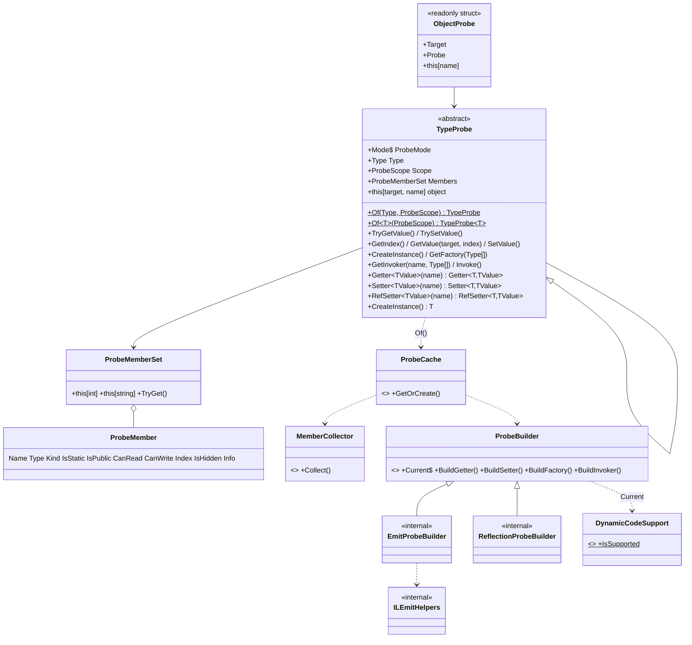

# ReflectProbe 설계

> FastMember 1.5.0 분석에서 가져갈 점(타입 단위 1회 생성 · 이름 → 인덱스 → IL switch · 판단은 생성 시점)은 유지하고,
> 고칠 점(캐시 경쟁 조건 · 모호한 접근 범위 · private 필드 미지원 · 박싱 · 래퍼 할당)은 바꾼 Reflection 대체 라이브러리.

## 1. 설계 결정 기록

| # | 항목 | 결정 | 이유 |
|---|---|---|---|
| 1 | 이름 | 패키지·네임스페이스 `ReflectProbe`, 클래스는 Probe 계열 | FastMember 의 Accessor 이름과 구분 |
| 2 | 타깃 | `netstandard2.1;net8.0` | Unity(Mono) 참조 가능 + 최신 런타임 |
| 3 | 디스패치 | 타입당 DynamicMethod 1개 + IL `switch` | FastMember 방식 계승. 해시 1번 + 점프 1번 |
| 4 | struct 대상 쓰기 | 강타입 API 에 `RefSetter<T,TValue>` 제공 | object 로 받으면 박스 사본에 써져 원본이 안 바뀜 |
| 5 | 예외 | `ProbeException` 계층 (`MemberNotFound` / `MemberNotReadable` / `MemberNotWritable`) | FastMember 는 전부 `ArgumentOutOfRangeException("name")` |
| 6 | Invoker 오버로드 | 이름 + 매개변수 타입. 이름만 주면 오버로드 1개일 때만 | 모호성 제거 |
| 7 | ObjectProbe | `readonly struct` | 래퍼 생성 할당 0 |
| 8 | 진입점 / 범위 | `TypeProbe.Of<T>(ProbeScope)` | |
| 9 | 기본 범위 | `ProbeScope.All` (Public · NonPublic · Instance · Static) | private 접근이 이 라이브러리의 차별점 |
| 10 | 백킹 필드 | `[CompilerGenerated]` 필드 제외 | 값은 프로퍼티 이름으로 접근 |
| 11 | 부모 private 필드 | BaseType 체인까지 수집, 이름 충돌 시 자식 우선 (가려진 멤버는 `IsHidden`, 인덱스로만 접근) | `GetFields(NonPublic)` 는 부모 private 을 돌려주지 않음 |
| 12 | readonly 필드 쓰기 | 인스턴스 readonly 허용, static readonly 불가 | static readonly 는 JIT 가 상수처럼 다룰 수 있음 (공식 문서 확인 필요) |
| 13 | AOT | Reflection 폴백 (아래 4장) | IL2CPP · NativeAOT 에서도 동작은 하게 |
| 14 | 캐시 | `ConcurrentDictionary<(Type, ProbeScope), Lazy<TypeProbe>>`, `ExecutionAndPublication` | 동시 최초 생성에도 IL 생성 1회 |
| 15 | 생성 경로 | DynamicMethod 만 사용, TypeBuilder 경로 없음 | 언로드 불가 + FastMember 동적 어셈블리 초기화 경쟁의 원인 |

### 계획서 초안에서 바뀐 점

- 초안의 `EmitTypeProbe` / `ReflectionTypeProbe` (TypeProbe 파생 클래스) → **`ProbeBuilder` 전략 2개** (`EmitProbeBuilder`, `ReflectionProbeBuilder`).
  - TypeProbe 는 빌더가 만든 델리게이트만 보관한다. 히트 경로가 `TryGetValue(name)` → 델리게이트 호출 1번으로 끝나고 가상 호출 단계가 없다.
  - 모든 TypeProbe 인스턴스가 `TypeProbe<T>` 여야 `Of(typeof(T))` 와 `Of<T>()` 가 같은 객체를 돌려줄 수 있는데, 구현을 파생 클래스로 나누면 이 조건과 충돌한다.
- `AmbiguousMemberException` 추가 (결정 6 의 "오버로드 2개 이상" 경우).

## 2. 클래스 구조



| 파일 | 공개 | 역할 |
|---|---|---|
| `TypeProbe.cs` | public | 타입 단위 진입점, 이름·인덱스 접근, 생성자, 메서드 |
| `TypeProbe.Generic.cs` | public | 강타입 Getter / Setter / RefSetter |
| `ObjectProbe.cs` | public | 객체 1개 래퍼 (struct) |
| `ProbeMember.cs`, `ProbeMemberSet.cs` | public | 메타데이터 |
| `ProbeScope.cs`, `ProbeMode.cs` | public | 범위 플래그, 생성 방식 |
| `ProbeDelegates.cs` | public | Getter, Setter, RefSetter, ProbeFactory, ProbeInvoker |
| `ProbeExceptions.cs` | public | 예외 계층 |
| `Internal/ProbeCache.cs` | internal | 동시성 캐시 |
| `Internal/MemberCollector.cs` | internal | 멤버 수집 + 이름 맵 (단일 목록에서 생성) |
| `Internal/ProbeBuilder.cs` 외 2개 | internal | Emit / Reflection 델리게이트 생성 |
| `Internal/DynamicCodeSupport.cs` | internal | 폴백 감지 |
| `Internal/ILEmitHelpers.cs` | internal | castclass / unbox / box 변환 |

## 3. 핵심 흐름

```text
TypeProbe.Of<Player>()
  └ ProbeCache.GetOrCreate(typeof(Player), All)
      ├ 히트 : Lazy.Value 반환 (락 없음)
      └ 미스 : Lazy 1개만 실행
          ├ MemberCollector.Collect → ProbeMember[] + name→index
          ├ ProbeBuilder.Current.BuildGetter / BuildSetter (IL switch DynamicMethod)
          └ new TypeProbe<Player>(...)

probe[p, "hp"]
  └ name→index TryGetValue → _getter(index, p) → switch(index) → ldfld hp → box
probe.GetValue(p, index)        ← 해시 생략
probe.Getter<int>("hp")(p)      ← 멤버 전용 DynamicMethod, 박싱 없음
```

## 4. AOT 폴백

- 감지 : 프로세스당 1회. net8.0 은 `RuntimeFeature.IsDynamicCodeSupported`, netstandard2.1 은 작은 DynamicMethod 생성·호출 시도 후 `PlatformNotSupportedException` / `NotSupportedException` 이면 폴백.
- 동작 : 공개 API 동일. 내부는 캐싱한 MemberInfo 로 GetValue / SetValue / Invoke. 강타입 API 도 박싱이 남는다.
- 확인 : `TypeProbe.Mode`. 테스트는 internal 생성 경로로 `ReflectionProbeBuilder` 를 직접 넣어 같은 테스트를 두 모드로 실행 (전역 스위치를 바꾸지 않아 병렬 테스트에 안전).
- Unity IL2CPP : 코드 스트리핑으로 메타데이터가 빠질 수 있어 `link.xml` 또는 `[Preserve]` 필요.

## 5. 범위 밖

ObjectReader(IDataReader), DLR `dynamic`, TypeBuilder 경로, ref/out 매개변수, 구조체 인스턴스 메서드 호출.

## 6. 구현 전 확인할 세부 항목

| 항목 | 현재 안 |
|---|---|
| `Getter<TValue>` 의 TValue 가 멤버 타입과 다를 때 | 정확히 일치할 때만 허용, 아니면 예외 |
| struct 대상에 `Setter<TValue>` 호출 | `NotSupportedException` (RefSetter 안내) |
| static 멤버의 강타입 Getter | target 인자를 무시 |
